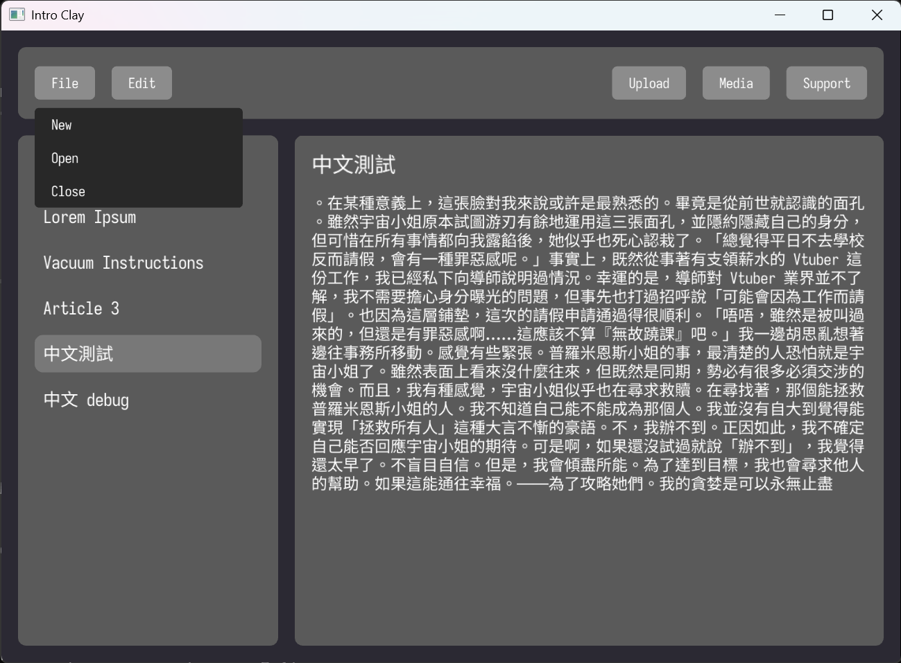
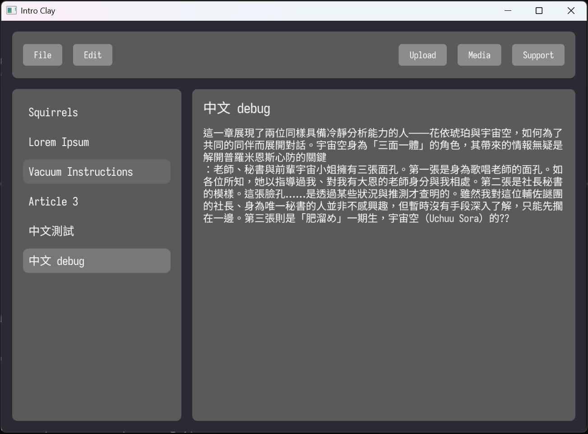

# Hello Clay

Test project for learning Clay 🤓.

> https://github.com/nicbarker/clay

## Start Up

Using `nob.h` created by tsoding
> https://github.com/tsoding/nob.h
> Just test on Windows with msys64 now, the nob.c need modify environment in differect OS.

```bash
$ clang nob.c -o nob.exe # kick off, only need once
$ ./nob.exe              # compile
$ ./bin/hello-clay.exe
```
## Modify

- Add unicode support at `libs/clay_renderer_raylib.c`, change the measure text function to `Raylib_MeasureTextUnicode`.

```c
int main(void) {
    ...
    Clay_SetMeasureTextFunction(Raylib_MeasureTextUnicode, fonts);
    ...
}
```
- Add CJK words wrap function to `libs/clay.h`, simply make a Kanji a word :D, not sure is this would cause performance impact.
  

## TODO

- There's bugs in CJK wrap, sometimes it would show `??`. Though I think it's unicode cutting issue, I still not found the problems.
  
